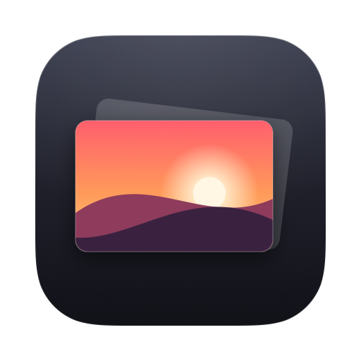
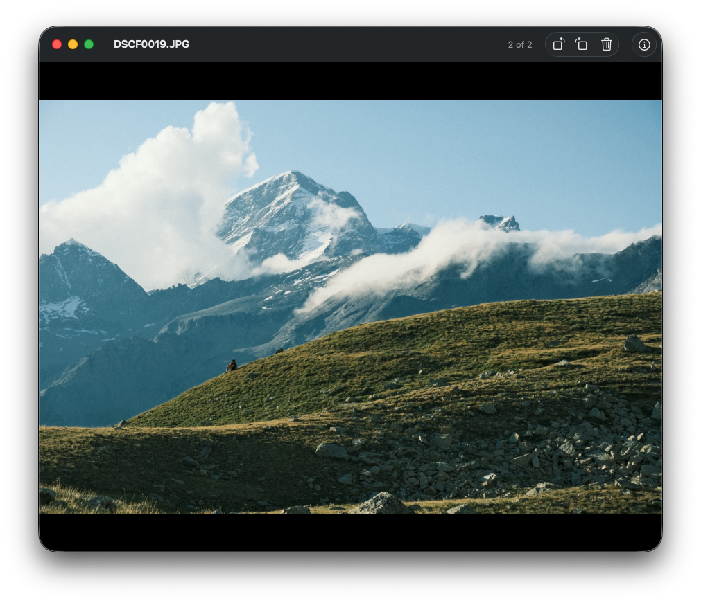

<div align="center">



# PicViewer

**A tiny picture viewer for your Mac that browses in the same order as Finder.**

Open a picture, then flip through its folder with the arrow keys. Films in the folder play in line. Rotate without losing quality, trash what you don't want, and nothing else.


<br>
<br>



</div>

## Why this exists

Preview doesn't step through the pictures in a folder: it only knows the files you opened together. Other viewers can browse a folder, but they sort it their own way, which is never how Finder sorts it. PicViewer follows Finder: sort the folder by name, date or size and the pictures go by in that same order.

## Shortcuts

| Key | Action |
| --- | --- |
| ← / → | Previous / next picture |
| Space | Play / pause a film |
| ⌘R / ⇧⌘R | Rotate clockwise / counter-clockwise |
| ⌘⌫ | Move to Trash (⌘Z puts it back) |
| ⌘I | Show or hide the info sidebar |
| ⌃⌘F or double-click | Full screen |
| ⌥⌘R | Show in Finder |
| ⌘O | Open a picture, film or folder |

## Install

1. Download **PicViewer-v….zip** from the [latest release](../../releases/latest). It's under "Assets" at the bottom of that page.
2. Double-click the zip to unzip it, then drag **PicViewer** into your Applications folder.
3. Open PicViewer. The first time, macOS says it can't check the app, because it isn't registered with Apple yet. Click Done, then open **System Settings → Privacy & Security**, scroll down, and click **Open Anyway** next to the message about PicViewer. You only need to do this once.

PicViewer needs macOS 14 Sonoma or newer on an Apple Silicon Mac.

To make PicViewer your default viewer: in Finder, select a picture, choose Get Info (⌘I), pick PicViewer under **Open with** and click **Change All…**. Do it once for each file type (JPG, RAF, HEIC and so on).

The first time you open a picture, macOS asks whether PicViewer may **control Finder**. Click Allow, because that's how it reads the folder's sort order. You can change this later in System Settings → Privacy & Security → Automation.

## How it works

**Folder order.** PicViewer first asks Finder about the folder's open window: the list view's sort column and direction, the icon view's Sort By, or the icon positions read row by row. If that doesn't work, it reads the view settings saved in the folder's `.DS_Store`, then Finder's default view settings, and finally sorts by name. The info sidebar shows which one was used (Details → Order).

**Lossless rotation.** Only the orientation flag changes: the EXIF orientation tags, XMP `tiff:Orientation` and the HEIF `irot` box are overwritten in place. Usually 1 to 3 bytes change and the file size stays the same. After writing, the file is read back to check the result, and if anything doesn't match, the original bytes go back. PNG files have no orientation flag, so they're re-written only if the decoded pixels come out bit-for-bit identical. If there's no lossless way, the rotation is refused and the file isn't touched.

**Turning the pixels.** Some apps and websites ignore the orientation flag. In Settings… (⌘,) you can choose **Rotate pictures by: Turning the pixels** instead. For JPEGs, PicViewer then rearranges the compressed 8×8 blocks directly, like `jpegtran -perfect`, so the picture is never decoded or re-compressed. The EXIF thumbnail and any embedded previews turn too, and the orientation flag is set back to normal. Before the file is overwritten in place, the result is checked twice: the compressed data is decoded again and compared block by block, and macOS renders it to make sure it looks right. The modification date is kept. If a JPEG can't be turned this way without losing an edge (its size isn't a multiple of the block size) or uses an unusual encoding (progressive), PicViewer says so and changes the flag instead. Other formats (RAW, HEIC, PNG) always use the flag.

**Films.** MOV and MP4 files rotate the same way: only the display matrix in the video track's header changes (36 bytes, overwritten in place), which is what a phone sets when you film upright. QuickTime, browsers, ffmpeg and Immich all follow it. The frames are never re-encoded, the file size stays the same, and the result is read back and checked before it's kept. The Turning the pixels setting doesn't apply to films.

## Limitations

- Finder's Group By is ignored; only the sort inside the view is used.
- Column and gallery views use the saved settings, not the live window.
- Mirrored HEIC orientations can't be rotated in place, so they're refused.
- Turning the pixels works only for JPEGs. Progressive JPEGs, and some sizes in some directions, use the orientation flag instead.
- Each update has a new signature, so macOS may ask for folder access again after updating.

## For developers

PicViewer is a native AppKit and SwiftUI app with no dependencies, built with the Command Line Tools alone (no Xcode project). `PicViewerCore` holds the folder order, the `.DS_Store` reader, lossless rotation (`LosslessRotation`, plus `JPEGLosslessTransform` for turning JPEG pixels) and metadata; the app target holds the window and views. If `jpegtran` is installed (`brew install jpeg-turbo`), the tests compare PicViewer's output with it.

```sh
swift test                                # run the tests
sh scripts/build-app.sh                   # build/PicViewer.app
sh scripts/build-app.sh --install         # build it and copy it to /Applications
sh scripts/make-icon.sh                   # re-render the icon (Resources/AppIcon.icns, Resources/AppIcon.icon, docs/icon.png)
```

Set `PICVIEWER_SAMPLES` to a folder of real camera files to also run the rotation tests on them (`swift test -c release`, because turning a 24 MP JPEG is slow in a debug build).

On macOS 26 the icon is drawn in Liquid Glass from `Resources/AppIcon.icon`, which needs Xcode's `actool`. If `actool` isn't set up (`xcodebuild -runFirstLaunch`), the build uses the plain `.icns` and macOS draws a light rim around it.

### Stop the permission prompts after every rebuild

macOS remembers folder permissions per code signature. Without a developer account the app gets a throwaway (ad-hoc) signature that changes with every build, so macOS treats each build as a new app and asks again. Create a local signing certificate once and every build gets the same signature:

1. Open **Keychain Access**, select the **login** keychain, and in the menu bar choose Keychain Access → Certificate Assistant → **Create a Certificate…**
2. Name it `PicViewer Local`, set Identity Type to **Self-Signed Root** and Certificate Type to **Code Signing**, then click Create.
3. Double-click the new certificate, open **Trust** and set Code Signing to **Always Trust**.
4. Rebuild with `sh scripts/build-app.sh --install`. It says `Signed with "PicViewer Local"`. Allow the folder access one last time.

### Releases

Work happens on `dev`; every push there replaces the **dev-build** prerelease. `main` only takes merges from `dev`, and every merge publishes the next version: the major.minor in `VERSION`, with the patch counting up from the last tag (`scripts/next-version.sh`). Note user-visible changes in [CHANGELOG.md](CHANGELOG.md).
